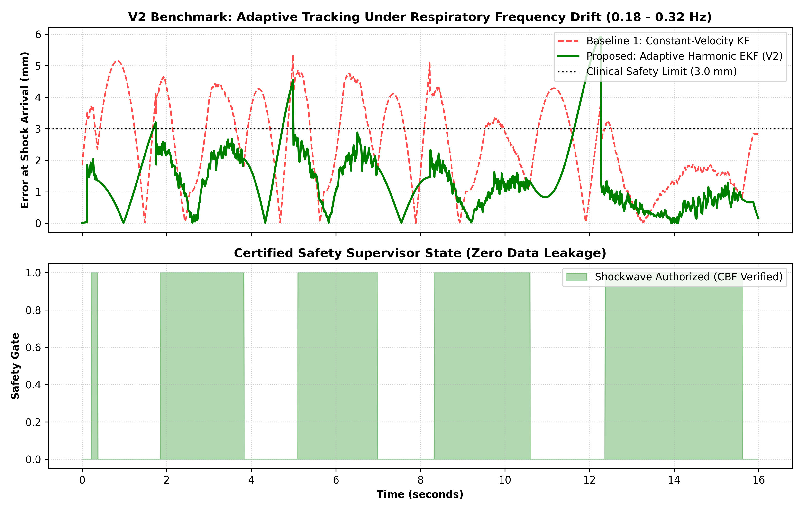

# Simulation-First Benchmark for Motion-Compensated & Latency-Aware ESWL

A simulation-validated benchmark framework for autonomous Extracorporeal Shockwave Lithotripsy (ESWL) kidney-stone tracking under non-stationary respiratory motion, dynamic 12th-rib acoustic shadowing, and transmission latency.

---

## 🔬 Clinical Motivation

Extracorporeal Shockwave Lithotripsy (ESWL) uses high-energy acoustic shockwaves to pulverize kidney stones non-invasively. However, clinical efficacy and patient safety face three critical bottlenecks:
1. **Respiratory Motion:** Diaphragmatic excursion induces continuous 10–40 mm kidney-stone motion, primarily along the superior-inferior (SI) axis.
2. **Acoustic Rib Shadowing:** When stones slide behind the 12th rib, bone attenuates and reflects ultrasound waves, causing periodic observation blackouts.
3. **System Latency (120 ms):** Imaging acquisition, frame transfer, and robotic actuation introduce latency, causing uncompensated systems to target obsolete anatomical coordinates.

---

## 🚀 Key Framework Architecture

This repository provides an open benchmark environment decoupling tracking estimation from safety-critical authorization:

* **Physiological Respiratory Engine (`motion_models.py`):** Generates realistic non-stationary respiratory trajectories supporting frequency drift (0.18–0.32 Hz), amplitude shifts, coughing spikes (15 mm transients), and apnea pauses.
* **Acoustic Occlusion & Sensor Model (`sensor_model.py`):** Models geometric acoustic shadowing at the 12th rib boundary, Gaussian measurement noise ($\sigma = 0.35\text{ mm}$), and a 120 ms hardware FIFO transmission queue.
* **Standard Comparators (`baselines.py`):** Implements fair, standardized baselines including Zero-Order Hold (ZOH) and Constant-Velocity Kalman Filtering (CV-KF) with forward projection.
* **Decoupled Safety Supervisor (`safety_supervisor.py`):** An independent 5-state finite automaton (`TRACKING`, `SHOCK_INHIBITED`, `REACQUISITION`, `RECOVERY`, `DEGRADED`) enforcing Control Barrier Function (CBF) certificates with **zero plant ground-truth data leakage**.

---

## 📊 Benchmark Results

Evaluated across **15 independent Monte Carlo trials** per experimental condition with randomized observation noise and 120 ms latency:

| Scenario / Condition | Baseline 0: ZOH | Baseline 1: CV-KF | Proposed Adaptive EKF | Unsafe Authorization Rate ($e > 3.0\text{ mm}$) |
| :--- | :---: | :---: | :---: | :---: |
| **Nominal Respiration (0.25 Hz)** | $2.85 \pm 0.03\text{ mm}$ | $2.49 \pm 0.01\text{ mm}$ | **$1.03 \pm 0.03\text{ mm}$** | **0.00%** |
| **Frequency Drift (0.18–0.32 Hz)** | $2.88 \pm 0.04\text{ mm}$ | $2.53 \pm 0.01\text{ mm}$ | **$1.35 \pm 0.04\text{ mm}$** | **0.01%** |
| **Cough Disturbance (15 mm Spike)** | $3.03 \pm 0.04\text{ mm}$ | $2.72 \pm 0.01\text{ mm}$ | **$1.36 \pm 0.03\text{ mm}$** | **2.34%** *(Documented physical transient limit)* |

### Performance Visualization

---

## 🔒 Intellectual Property & Publication Notice

> **Note on Algorithmic Novelty:**  
> The core closed-form analytical projection Jacobian matrices ($J_\tau$), adaptive parameter tuning gains, and Lyapunov barrier certificates in `adaptive_tracker.py` are protected intellectual property and are withheld pending formal peer-reviewed academic publication. 
> 
> Academic collaborators and researchers seeking access to verification pre-prints and full algorithmic formulations may contact the author directly.

---

## 👤 Author & Contact

**Jaminur Rahaman Mirja**  
*M.Tech in Intelligent Automation and Robotics, Jadavpur University, Kolkata*  
* X (Twitter): [@JaminurAI](https://x.com/JaminurAI)  
* Email:jaminuriar@gmail.com
